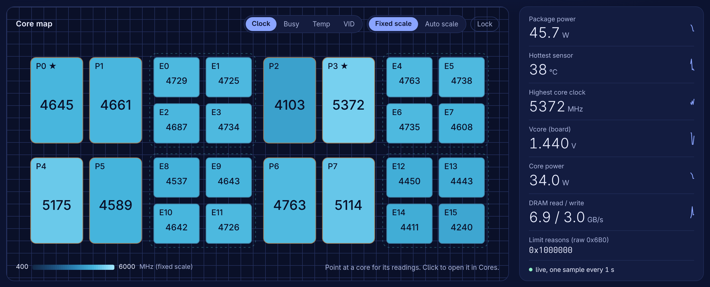
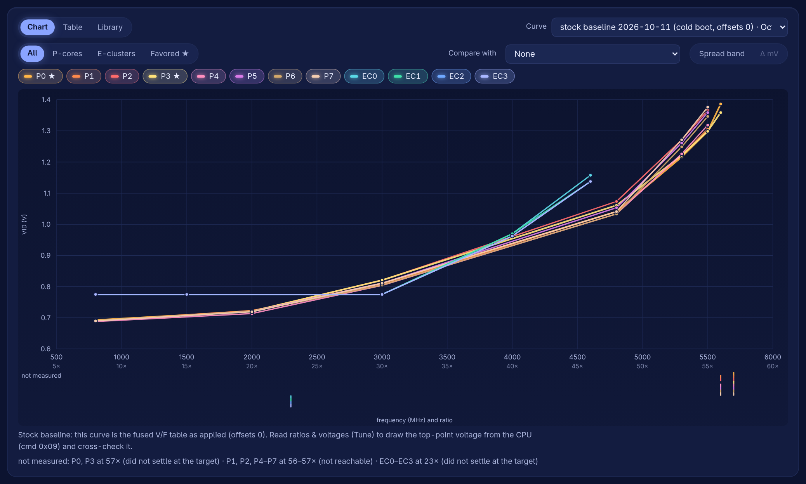
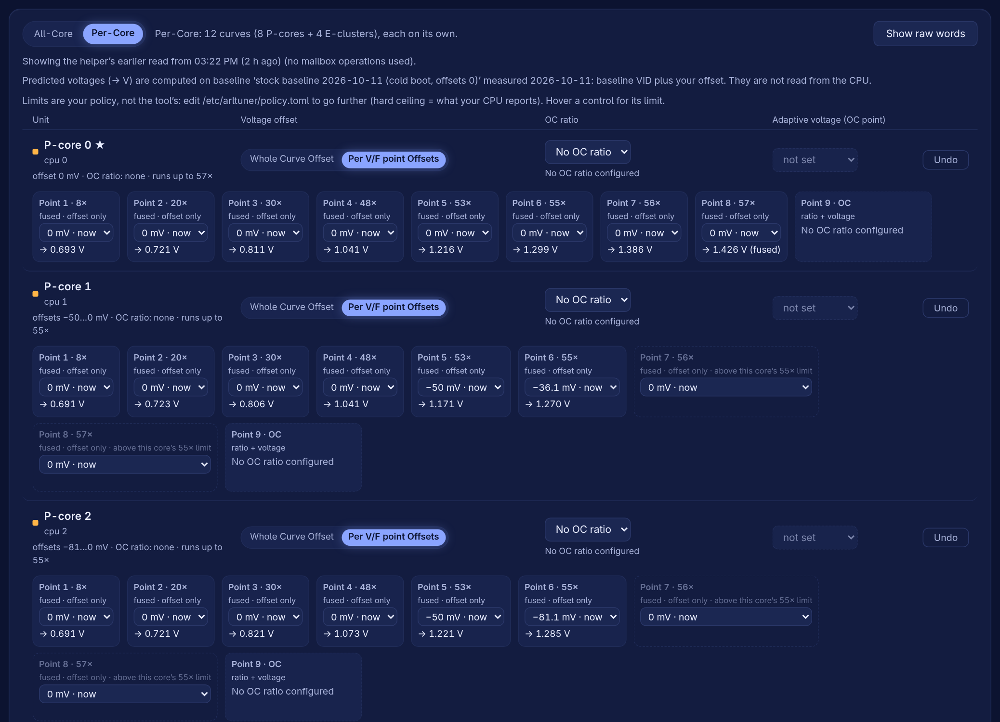
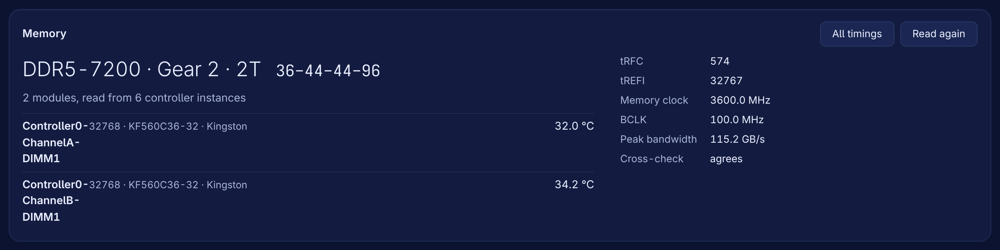
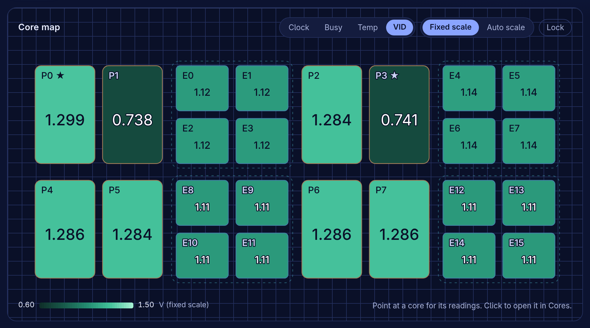
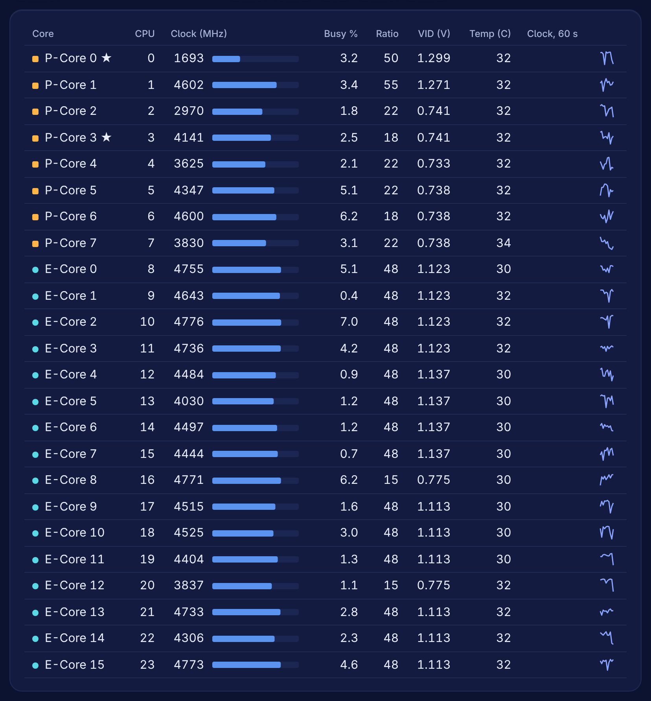
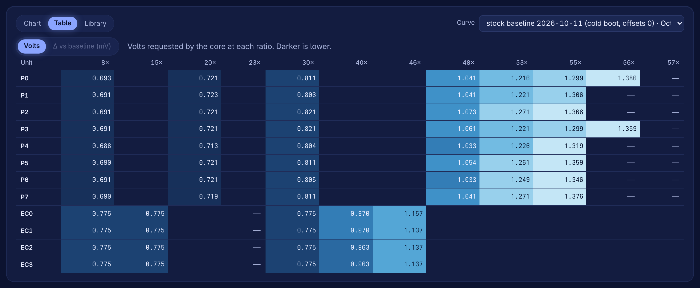
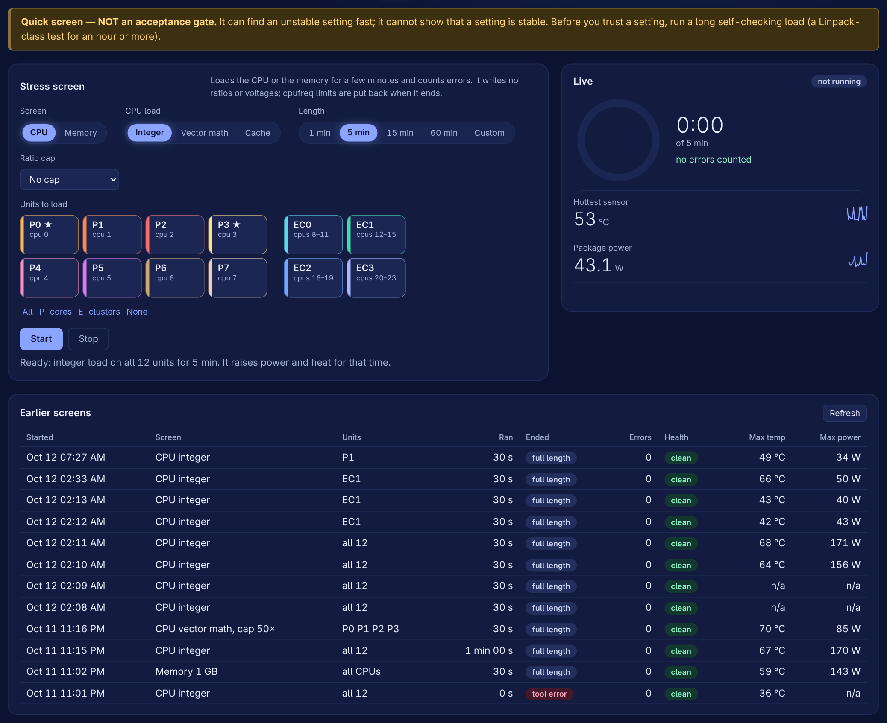
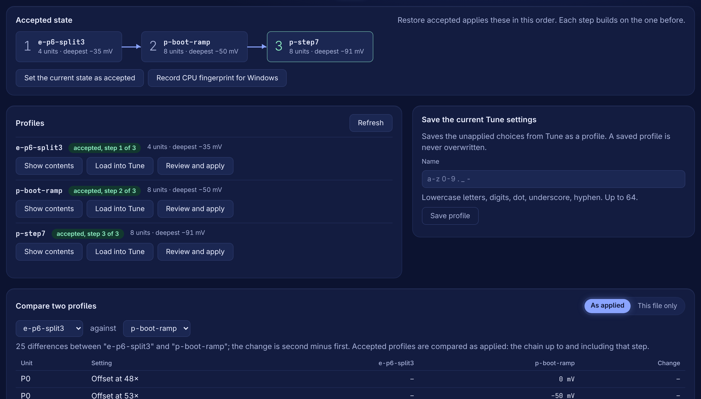
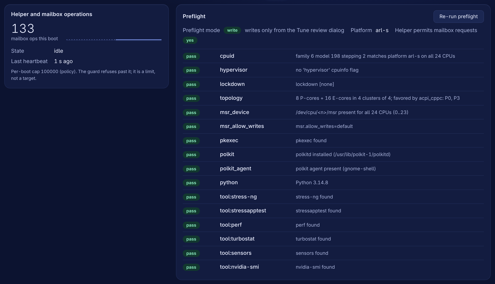

# arrowlake-tuner

**Per-core undervolt, V/F curve, ratio and turbo-table tuning for Intel Core Ultra 200S (Arrow Lake-S) on Linux** — an open, safety-first
alternative to Intel XTU for Linux, with a local web GUI, live telemetry and built-in stability screens. Windows gets a matching PowerShell restore.

Keywords: Arrow Lake undervolt Linux · Core Ultra 9 285K · V/F curve · per-core voltage offset · OC mailbox (MSR 0x150) · turbo ratio limits ·
XTU alternative · stress test · stressapptest · stress-ng.

## Status (2026-10-12)
- **GUI (local web app + root helper) working on the reference machine:** live dashboard with memory timings, V/F curve **measurement** and
  storage, **tuning** (Per V/F point Offsets / Whole Curve Offset, OC point + adaptive voltage, OC ratios, turbo tables) with plan → review → apply →
  read-back, stress/validation screens, profiles. Verified on hardware 2026-10-11/12 (`docs/knowledge/tuning-results.md`). Start with
  the **user guide, `docs/guide/README.md`**.
- **CLI + restore scripts** (Linux and Windows; the Windows restore finds your cores from a fingerprint recorded on Linux and is not yet tested on real Windows in its current form). Offline suite: `python3 tools/run_tests.py` (≈ 2250 tests, simulator only).
- **No tuning ships with the repo (D-036).** A fresh install has no accepted state: you create it in the app (Tune, then Profiles > Set as accepted).
  One chip's results are kept as an illustration only in `examples/reference-285k/` — never apply them to another CPU.

**Supported:** Intel Core Ultra 200S, Arrow Lake-S desktop (CPU family 6, model 198), on Linux. Developed and verified on a Core Ultra 9 285K
(`docs/HARDWARE.md`); everything the app shows is read from your machine. Other CPUs are refused or read-only.

## Screenshots
Everything below is the app's own web page, captured from one example machine (Core Ultra 9 285K); the numbers are that machine's, yours will differ.


*Dashboard: every core's live clock on the die layout (recolour by busy, temperature or VID), with package and core power, temperatures and DRAM traffic.*


*Curves: the measured V/F curve of every P-core and E-cluster, so you can see which cores need the most voltage.*


*Tune: one row per core or cluster, a whole-curve or per-point voltage offset, the OC point and ratio. Nothing is written until Review, then Apply, then read-back.*

<details>
<summary>More pages</summary>

| | |
|---|---|
|  |  |
| *Memory: speed, gear, timings and DIMM temperatures, read from the memory controller.* | *Core map by VID: the voltage each core is requesting right now.* |
|  |  |
| *Cores: every core's clock, load, ratio, VID and temperature with a 60 s trend.* | *Curves as a table: the measured volts per unit and ratio.* |
|  |  |
| *Stress: a quick screen of chosen cores (not an acceptance gate); shown idle.* | *Profiles: save your Tune settings, set the accepted state that Restore brings back.* |
|  | |
| *System: helper state, the per-boot mailbox budget and the preflight checks.* | |

</details>

## Safety
Writing CPU voltages can corrupt data or crash the machine. Every write goes through a guard (allowlist, policy limits), one mailbox transaction
at a time, a review → apply step, read-back and an audit log. **A cold boot reverts every change** — that is also the universal undo. Rules:
`docs/SAFETY.md`.

## 1. Requirements
| What | Needed | Check |
|---|---|---|
| CPU | Intel Core Ultra 200S desktop, Arrow Lake-S (CPU family 6, model 198) | `grep -m1 "model\s*:" /proc/cpuinfo` → 198 |
| OS | Linux on bare metal (no VM), systemd + polkit + a desktop polkit agent (GNOME/KDE) | System tab → preflight |
| Python | ≥ 3.12, standard library only (nothing to pip-install) | `python3 --version` |
| Kernel | `msr` driver (`/dev/cpu/*/msr`); kernel lockdown `none`; `msr.allow_writes` not `off` | `cat /sys/kernel/security/lockdown` |
| Browser | any current Chromium/Firefox (the GUI is a local web page on a random loopback address `127.x.y.z`, printed when it starts; not reachable from the network) | |
| Optional tools | `stress-ng`, `stressapptest` (Stress tab), `turbostat`, `perf`, `lm_sensors` | Fedora: `sudo dnf install stress-ng stressapptest kernel-tools perf lm_sensors` |

Secure Boot normally switches the kernel into lockdown, which blocks MSR writes: the app then runs **read-only** (dashboard, curves still work).

## 2. BIOS / firmware settings (once)
| Setting (names vary by board vendor) | Value | Why |
|---|---|---|
| **Undervolt Protection (UVP)** | **Disabled** | with UVP on, the CPU rejects runtime voltage offsets below the fused floor |
| **OC Lock / Overclocking Lock** | **Disabled** | with it on, every OC-mailbox write is refused (`OCLocked`) |
| Overclocking feature / "OC support" (some boards) | Enabled | some boards hide the CPU's OC mailbox otherwise |
| Secure Boot | Disabled (or a kernel without lockdown) | lockdown blocks MSR writes (see above) |
| Per-core voltage / V/F offsets in BIOS | **not required** — leave at Auto/0 | the app writes per-core and per-point offsets itself at runtime; BIOS offsets stack *on top* of what the app shows |

These are the settings the reference machine used (ASRock Z890, BIOS 3.40); the app's **System → preflight** tells you what it found. If a write
is refused with `OCLocked` or reads back unchanged, re-check UVP and OC Lock first.

## 3. Install
```
git clone https://github.com/xyehya/arrowlake-tuner && cd arrowlake-tuner
python3 tools/run_tests.py          # optional: offline test suite (simulator, ~3 min)
sudo bash install.sh                # code → /usr/lib/arltuner, GUI → /usr/share/arltuner/web, policy → /etc/arltuner, audit → /var/lib/arltuner
```
The installer ends with a self-check ("all N checks passed"). It never applies any tuning and never touches an existing policy or accepted state.

## 4. Run
```
python3 tools/arltuner-gui.py --open    # one polkit password prompt, then the browser opens the dashboard (a random http://127.x.y.z:PORT address)
```
- Forgot the login link or closed the tab: run `python3 tools/arltuner-gui.py` again — it prints a fresh one-time link for the running GUI.
- Stop the GUI: Ctrl+C in that terminal (the root helper exits with it).

**First session (in the app, in this order):**
1. **Curves → Measure (Quick)** right after a cold boot, name it "stock", **mark as baseline** (predictions on the Tune page use it).
2. **Tune → Read ratios & voltages**, change one thing (e.g. one core's top point −20 mV) → **Review → Apply** → read-back must match.
3. **Stress** the changed cores (5–15 min), then your own long gate (e.g. OCCT/Linpack 60 min) before trusting it.
4. **Profiles → Save**, then **Set as accepted** — this is what "Restore accepted" brings back after a reboot.
Details per tab and the background facts: the user guide, `docs/guide/README.md`.

## 5. After every reboot
A **cold boot clears every runtime change** (a warm reboot may keep some). To get your accepted tuning back, either:
- GUI: start it (section 4) → **Tune → Restore accepted** → Review → Apply; or
- terminal: `bash tools/lnx/restore_tuning.sh` → type `CONFIRM` once → ends with "RESTORED: all cores/clusters match"
  (`--check` = compare only, no writes).
Nothing is applied automatically at boot (by design, for now).

## 6. Update / reinstall / remove
| Task | Command |
|---|---|
| Update | stop the GUI (Ctrl+C) → `git pull` → `sudo bash install.sh` (keeps policy, accepted state, audit log) |
| Reset the policy to the shipped default | `sudo bash install.sh --reseed-config` (replaces `/etc/arltuner/policy.toml` with `policies/default.toml`) |
| Remove the app | `sudo bash uninstall.sh` (keeps `/etc/arltuner` + audit log) · everything: `sudo bash uninstall.sh --purge --yes-reset-budget` |

The installer refuses to run while the GUI's helper is running — stop the GUI first.

## 7. Limits (policy `/etc/arltuner/policy.toml`)
**Every limit is your policy, not a built-in rule (D-039).** The shipped defaults are conservative: offsets −200…+200 mV; the voltage-target and OC-ratio ceilings are `"auto"` (the CPU's own
maximum voltage from mailbox command `0x28`; the fused ratio + 3). Edit the numbers in `/etc/arltuner/policy.toml` as root to go further (extreme-cooling users can); they apply from the next read or plan. The only
ceilings you cannot edit are what **your CPU itself reports** (OC-ratio limit `0x01`, maximum voltage `0x28`, read live) and the register field widths (offset −1000…+999 mV), at your own risk. The Tune
page and System → Tuning limits show each limit next to what your CPU allows. One mailbox transaction at a time, the guard, read-back and the audit log always stay on. Details: `docs/guide/12-safety-and-internals.md`.

## 8. Troubleshooting
| Symptom | Likely cause |
|---|---|
| Banner "read-only" / writes disabled | System → preflight: lockdown on (Secure Boot), `msr.allow_writes=off`, no polkit agent, or not an Arrow Lake-S CPU |
| Apply refused `OCLocked` / nothing changes on read-back | BIOS OC Lock or Undervolt Protection still on |
| Crash / reboot / errors under load | the tuning is unstable: cold boot (reverts all), then less negative offsets |
| "No accepted state yet" | you have not used Profiles → Set as accepted yet |

## Developers: quick start without hardware
```
python3 tools/run_tests.py                       # offline suite (simulator only)
python3 tools/arltuner.py topology               # 24-core map
python3 tools/arltuner.py plan examples/reference-285k/profiles/p-step7.toml --sim --policy policies/default.toml   # a plan against the simulator
```

## Layout
| Path | Purpose |
|---|---|
| `AGENTS.md`, `CLAUDE.md`, `docs/ORCHESTRATION.md` | rules for agent sessions; how the orchestrator runs the project; `docs/START-PROMPT.md` = how to resume |
| `docs/STATE.md` · `docs/SPEC.md` · `docs/ROADMAP.md` · `docs/tasks/` | live state · product spec · phases · tasks |
| `docs/SAFETY.md` · `docs/DECISIONS.md` · `docs/ARCHITECTURE.md` | write protocol · decision log · module contracts |
| `docs/guide/` | the user guide: requirements, install, first run, V/F primer, measuring, undervolting, overclocking, stability, profiles and restore, CLI, FAQ, safety |
| `docs/knowledge/` | distilled facts: registers (single source of truth), platform, tuning results, Linux/Windows paths |
| `src/arltuner/`, `tests/`, `tools/` | library + CLI, tests, Linux/Windows scripts |
| `policies/` · `examples/` | the generic root policy installed as the default · one chip's results, illustration only (nothing reads them) |

## History and sources
The project began as per-core tuning research on the reference machine (Core Ultra 9 285K, ASRock Z890) and became this application on 2026-10-08;
`docs/knowledge/` holds the facts that research established. Register facts were established by measurement and by studying vendor tools for
interoperability; no vendor code or binaries are included.
